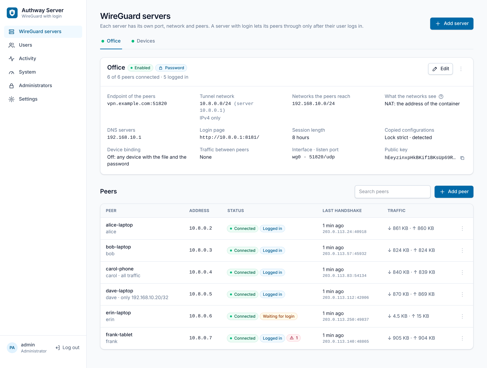
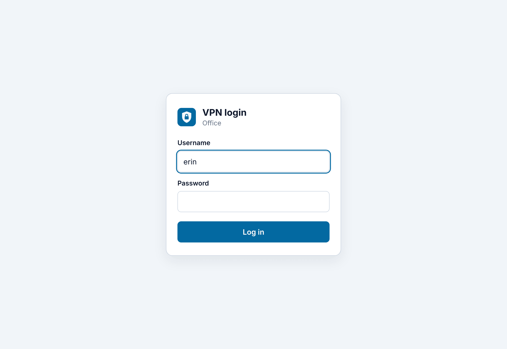
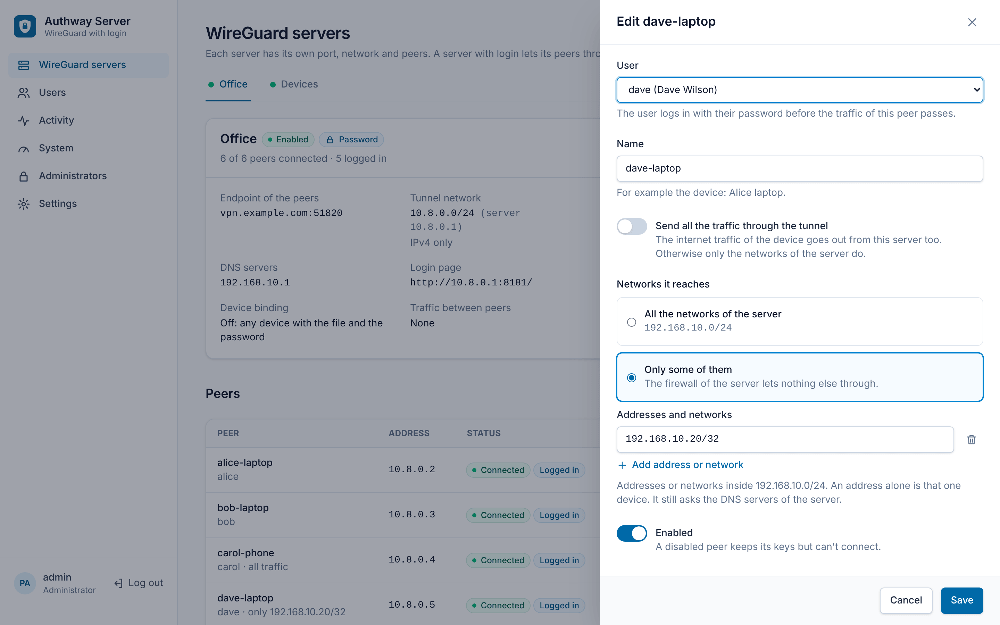
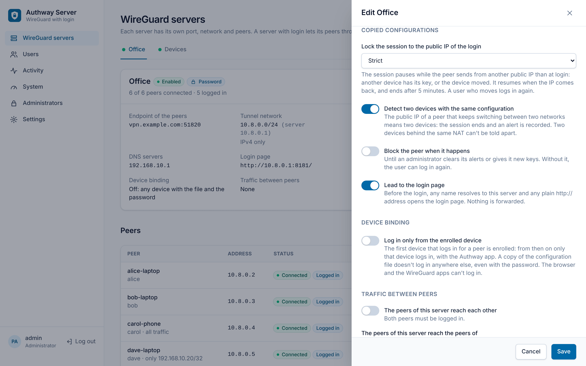
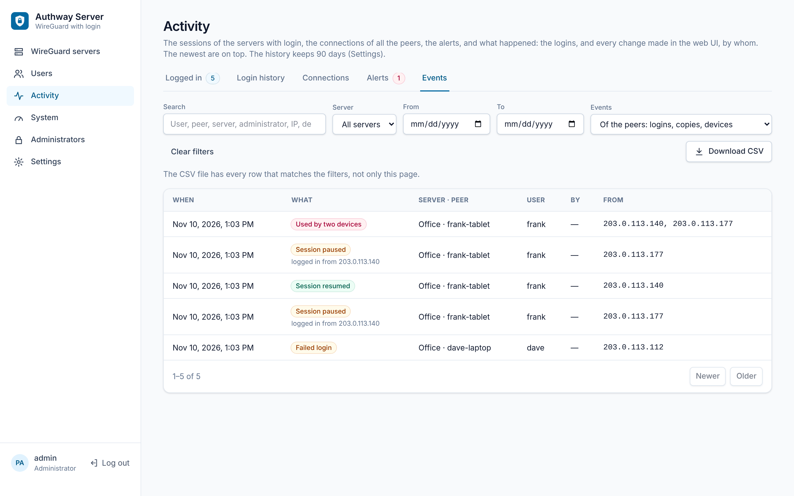
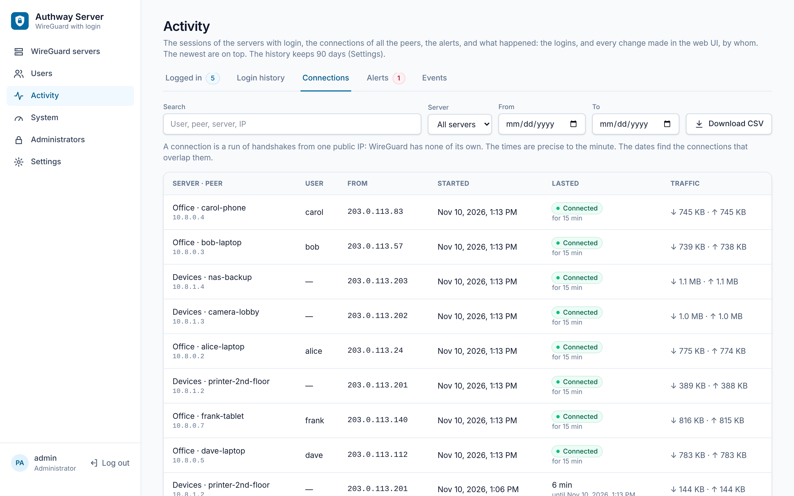
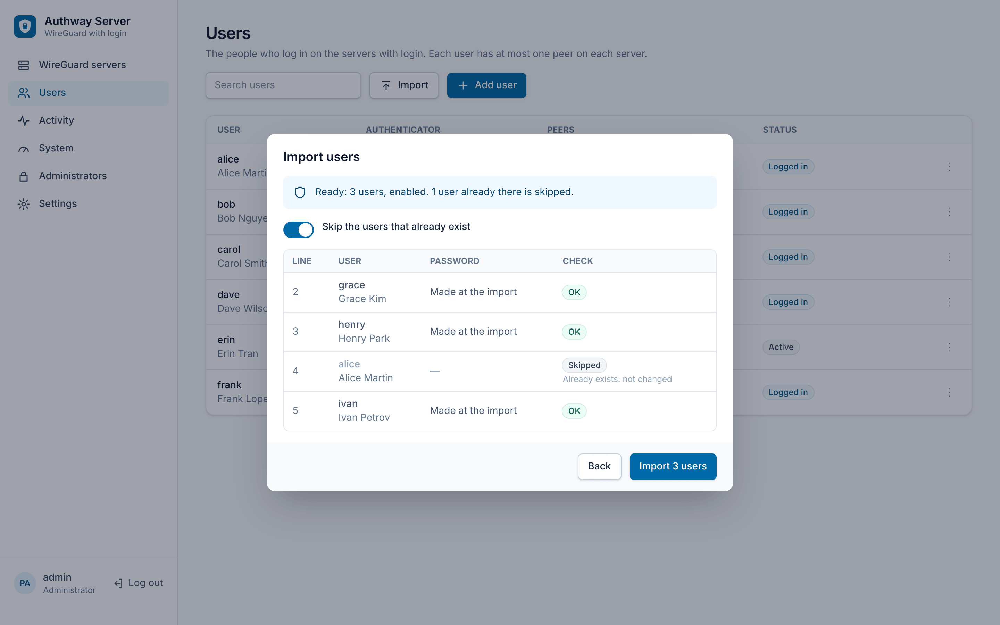
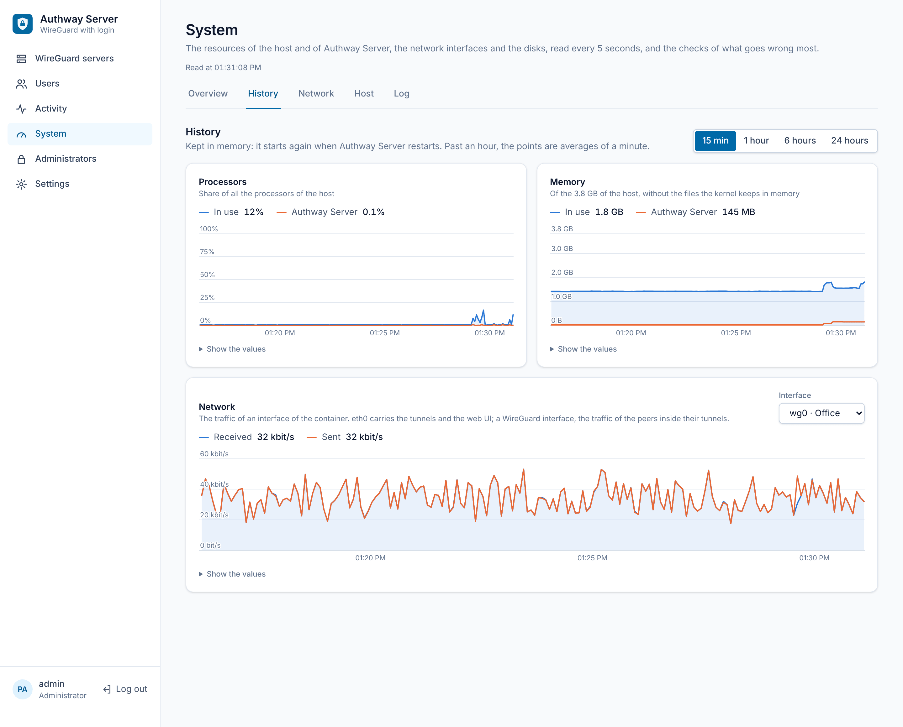
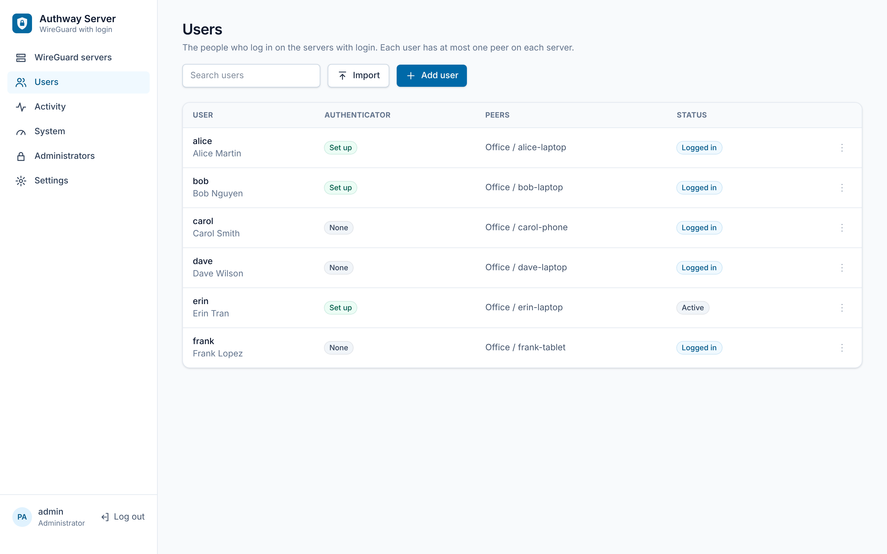

# Authway Server

> [!WARNING]
> **A proof of concept written by an AI** (Claude, by Anthropic). Expect bugs. Test it before you rely on it.

Authway Server runs WireGuard servers in Docker, on any Linux host, and puts a login in front of them: the peers of a
server reach nothing but a login page until their user logs in with a password, and optionally the code of an
authenticator app. It has a web UI for the administrators.



## A copied configuration file isn't enough

A plain WireGuard configuration file is a key: anyone with a copy connects, from anywhere, for as long as the peer
exists. Authway Server lets you choose, for each server, how much a copy is worth:

- **The login**, on a server with *password* or *password and authenticator code*: a copy connects, but reaches only
  the login page without the password of the user, and the code of their authenticator app.
- **The lock to the public IP of the login**: with the *strict* lock, the session pauses whenever the peer sends from
  another public IP than at the login, so a copy used from another network gets nothing while the user is logged
  in.
- **Two devices with the same key**: when the real device and a copy are both on, the session ends, an alert is
  recorded, and the peer can be blocked until an administrator looks at it.
- **Device binding**, with the Authway app: only the computer enrolled for the peer logs in, so the file and the
  password copied to another computer don't. Then Authway gives the peer a WireGuard key of its own: the file, and
  every copy of it, no longer even connects.

How each one works: [Protection against copied configuration files](docs/features.md#protection-against-copied-configuration-files).

## The apps

- **[Authway](https://github.com/phatdo1819/authway)**, for Windows and macOS: imports the configuration file, opens
  its login window by itself when the tunnel comes up, and is the only app for the servers with device binding.
- **The official WireGuard apps**, on Windows, macOS, Linux, iOS and Android: on a server with *WireGuard key only*
  they work as with any WireGuard server. On a server with *password* or *password and code*, the user turns the
  tunnel on, then opens any plain `http://` address in a browser, `http://neverssl.com` for example: the login page
  of the server opens, and after the login the tunnel works until the session ends.

Step by step: [Connect a device](docs/first-steps.md#connect-a-device).

## Screenshots

| | |
|---|---|
| [](docs/screenshots/login.png) | [](docs/screenshots/peer-access.png) |
| **The login page**, that a peer reaches before anything else | **Access rules**: a peer reaches only the addresses you choose |
| [](docs/screenshots/server-login.png) | [](docs/screenshots/activity.png) |
| **Copied configurations**: the lock to the IP of the login, the detection, device binding | **Events**: a file used by two devices, its session paused, a failed login |
| [](docs/screenshots/connections.png) | [](docs/screenshots/import.png) |
| **Connections**: who connected, from where, how long, how much | **Import**: users from a CSV file, every row checked first |
| [](docs/screenshots/system.png) | [](docs/screenshots/users.png) |
| **System**: the checks, the resources and their history, the log | **Users**, their authenticators and their peers |

The screenshots show a demo: the users, the peers and the addresses are made up.

## What it does

- Several WireGuard servers in one container, with IPv4 and IPv6 in the tunnels, and peers with a configuration file
  and a QR code.
- For each server: the login, the protections against copied files, NAT or routed towards its networks, and the
  traffic between peers. For each peer: all the networks of its server, or only some of them.
- A web UI for the users, the peers, who is logged in, the connection history, the alerts, every change made, and a
  System page that checks the host. Users in bulk from a CSV file, and two administrators can edit at once without
  undoing each other's changes.
- Administrators with roles and authenticator apps, a password policy, and backups encrypted with a passphrase.

All of it: [Features](docs/features.md).

## Quick start

On a Linux host with WireGuard in its kernel, Linux 5.6 or later:

```sh
git clone https://github.com/phatdo1819/authway-server.git authway-server
cd authway-server
sudo ./install.sh
```

The script installs Docker when it's missing, asks for the address of the host in your local network and for its
public name or IP address, builds and starts Authway Server, and prints the first administrator and its password.
Then open `https://<the address of the host>:8443` and follow the [First steps](docs/first-steps.md).

## Upgrade and go back

```sh
cd authway-server && git pull
sudo ./install.sh              # upgrade: the data and the settings stay
sudo ./install.sh --rollback   # go back to the version before the last upgrade
```

Before an upgrade the script copies the database and keeps the version that ran. When a new version changes the
schema of the database, it copies the database again before changing it, and the version of before can't open it
any more: `--rollback` then puts the copy back, and keeps the newer database aside. Details:
[Upgrade](docs/install.md#upgrade).

## Documentation

| Page | What's in it |
|---|---|
| [Features](docs/features.md) | Everything Authway Server does, server by server and in the web UI |
| [Install](docs/install.md) | What the host needs, the install script and its options, installing by hand, the router, upgrading, uninstalling |
| [First steps](docs/first-steps.md) | From the first login to the first peer, and connecting a device with Authway or a WireGuard app |
| [Good to know](docs/good-to-know.md) | Ports and security, running it, data and backups, administrators, peers and devices, troubleshooting |
| [IPv6](docs/ipv6.md) | IPv6 in the tunnels and on the Docker network |
| [Routed servers](docs/routed-servers.md) | Letting the networks see the address of each peer: through the Docker host, or on macvlan, and switching between NAT and routed |
| [Development](docs/development.md) | Building and testing the source |
| [Design](docs/design.md) | How it works inside |

## Contributing

Everyone is welcome to contribute: bug reports, ideas, fixes, documentation, and tests on other hosts and networks.
The goal is a WireGuard server with a real login that anyone can run, for free, on any Linux host, so every
contribution counts. And since this is a proof of concept written by an AI, reviews of its security are especially
welcome.

Open an issue to report a bug or talk about an idea, or a pull request with a change: [Development](docs/development.md)
explains how to build and test the source.

## License

MIT, see [LICENSE](LICENSE).
